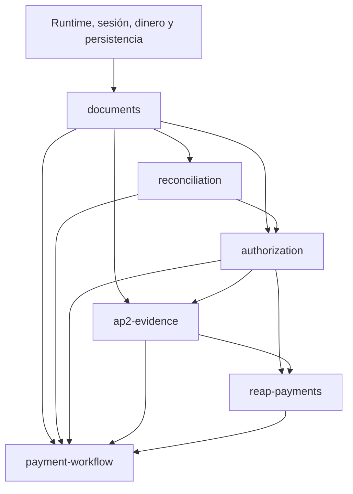

# Plan de implementación: PoPayments

Estado: aprobado por el usuario. Implementación en curso desde el 2026-10-09. El runtime Docker, acceso, documentos, conciliación y parte de autorización y del adaptador Reap ya tienen código; el recorrido de pago y agente sigue pendiente.

## Objetivo y alcance

Entregar la demo aprobada: carga JSON/XML propio, coincidencia de cuatro campos, autorización previa de PO, excepciones justificadas, evidencia AP2 con identidades de prueba y checkout Reap Agentic a Acteck en sandbox. La persona debe poder comprobar los documentos, quién autorizó, qué términos se aceptaron y el resultado real del checkout.

Fuente de verdad: [mapa e índice](../CAPABILITY-MAP.md), [convenciones](../SPEC-CONVENTIONS.md) y [ADR-001](../docs/decisions/0001-arquitectura-demo.md). Las tareas se registran únicamente en [todo.md](todo.md). Un checkbox se marca después de satisfacer aceptación y verificación; no representa avance estimado.

## Arquitectura y dependencias

Se conserva el monolito modular Next.js/TypeScript, PostgreSQL y worker Node. Autorización, verificación AP2 y exclusión del pago son controles de servidor. El LLM coordina herramientas. La base de datos almacena decisiones, outbox e intención antes de efectos de red.

El usuario precisó que la demo debe correr en un sandbox Docker. La entrega incluye Dockerfile y Compose con `db`, `migrate`, `web` y `worker`, volumen persistente y variables de entorno externas. La URL pública del sandbox debe usar HTTPS para retornos Reap. T04/T45 incluyen verificación de configuración y arranque en un host con Docker.

Se implementan los contratos proveedores en el orden del mapa. Algunas pantallas/handlers del consumidor se añaden al completar cada capacidad para hacerla verificable de extremo a extremo: carga y consulta, diferencias y evidencia. Esas adaptaciones no introducen imports hacia workflow desde módulos inferiores. La automatización durable y el agente completo llegan al final, después de probar sus controles.

No se crea todo el esquema de una vez: cada capacidad incorpora su migración, servicio, contrato y prueba. Un fichero de migración ya aplicado no se edita; se añade uno nuevo. No se mantienen transacciones durante HTTP/OpenAI.

## Verificación temprana

T01 registra disponibilidad de Agentic/EXTERNAL, Acteck, variantes, moneda, versión, identidad del propietario, retorno HTTPS y acceso OpenAI. Solo admite consultas y validaciones sin efectos; nunca compra ni enrola. Si faltan datos, registra UNKNOWN/BLOCKED con evidencia saneada. Se puede desarrollar con proveedores simulados, pero T44 no se completa hasta demostrar la integración.

T08 verifica SD-JWT y delegación con vectores independientes antes de desarrollar el módulo AP2 completo. Candidato exacto: `@sd-jwt/core@0.22.0`, consultado en el registro oficial al planificar. La biblioteca declara compatibilidad con RFC 9901; eso no prueba que implemente la delegación del borrador. Se utilizará la capa de perfil aprobada y jose. No se incorpora sd-jwt-vc ni otra dependencia si no resulta necesaria. [Biblioteca oficial](https://sdjwt.js.org/) y [metadatos de la versión](https://registry.npmjs.org/@sd-jwt/core/0.22.0).

Las demás versiones se fijan conforme a las convenciones y se comprueban conjuntamente durante T02/T06. Si un paquete no existe o no es compatible, registrar el problema y revisar las convenciones antes de sustituirlo; no bajar silenciosamente el contrato de seguridad o delegación.

## Índice ordenado de tareas

| Fase | Tareas | Resultado verificable |
|---|---|---|
| Preparación | T01–T08 | Diagnóstico externo, runtime comprobado y viabilidad criptográfica. |
| Acceso y documentos | T09–T15 | Login; cargar, versionar y consultar documentos dentro de un caso. |
| Conciliación y autorización | T16–T21 | Comparación reproducible, revisión/consentimiento y reserva exclusiva. |
| Evidencia AP2 | T22–T26 | Cadena abierta/cerrada, verificación y export autenticado. |
| Reap | T27–T33 | Enrollment, plan, cotización y checkout con recuperación segura. |
| Operación y agente | T34–T41 | Jobs persistentes, consola completa y coordinación con herramientas. |
| Verificación de entrega | T42–T45 | Accesibilidad, recorridos, sandbox demostrado y guía reproducible. |

Hay un punto de verificación cada dos o tres tareas. No se abre automáticamente trabajo paralelo: esta ejecución es secuencial. Cambios de esquema, contratos comunes y reservas requieren mantener ese orden. Los módulos de presentación pueden separarse en otra sesión solo después de estabilizar sus contratos y coordinar explícitamente los archivos compartidos.

## Barra común de finalización

Por tarea: criterios satisfechos, verificación enfocada que observe comportamiento, tipos/lint sin supresiones nuevas, cambios limitados al alcance y documentación actualizada. Las pruebas de lógica se escriben antes de cambiar comportamiento; los casos críticos no se sustituyen por tests que simplemente copien la implementación.

Por checkpoint: ejecutar los tests existentes afectados y `npm run typecheck`, `npm run lint`, `npm run build` una vez que esos scripts estén creados. Probar por HTTP/navegador el recorrido habilitado. No repetir suites amplias salvo fallo o riesgo concreto. Por entrega: todos los escenarios de las specs cubiertos, navegador verificado, historial/evidencia inspeccionables e integración sandbox demostrada separadamente de los doubles. Aplicar la [Definition of Done](../.agents/references/definition-of-done.md) al contexto de la demo.

Los tests predeterminados no mutan proveedores. Sandbox es opt-in, con credenciales externas y consentimiento de compra/instrumento ya válido. Las claves, tarjeta y OTP compartidos no se copian a fixtures, logs, commits ni archivos del plan. Las pruebas de recuperación simulan incertidumbre sin crear un segundo cargo real.

## Riesgos y respuesta

| Riesgo | Consecuencia | Tratamiento y condición de salida |
|---|---|---|
| Acteck o EXTERNAL no habilitados | No puede demostrarse checkout aprobado. | T01 diagnostica; T44 exige evidencia real. Mantener bloqueo visible, sin reemplazar merchant. |
| Llave Reap vence el 11 de octubre a las 00:00 de Ciudad de México | Mutaciones rechazadas. | Configurar expiración; validar llave vigente antes de sandbox y solicitar renovación si hace falta. |
| Falta owner/email, HTTPS o OpenAI/modelo | Enrollment/agente no ejecutables. | T01 enumera campos faltantes; los adaptadores y pruebas locales siguen siendo verificables. |
| Delegación incompatible con biblioteca | Evidencia no cumple el perfil aprobado. | T08 usa vectores; revisar spec si falta capacidad, sin reducirla a JWT independientes. |
| Precio/envío cambian o quote expira | Autoridad y evidencia quedan obsoletas. | Comparar snapshot, pedir consentimiento correspondiente y generar evidencia nueva. |
| Timeout, crash o idempotencia Reap caducada | Riesgo de duplicar un cargo. | Persistir clave/cuerpo e intención, mantener reserva UNKNOWN y consultar antes de crear otro intento. |
| Imports circulares o contratos UI divergentes | Modificación extensa y controles duplicados. | Tipos en proveedor; coordinador transmite snapshots; guardas del servidor, UI solo representa acciones. |
| Tutorial y referencia Reap difieren | Suposiciones incorrectas sobre flujo alojado. | Fijar versión, validar contratos y atender nextAction/estado observado; documentar discrepancia en T01. |

## Preguntas y condiciones pendientes

Las decisiones de producto y arquitectura están aprobadas. No hace falta repetir la entrevista. Quedan verificaciones externas y de compatibilidad ya previstas: disponibilidad Reap/Acteck, identidad del propietario/email de prueba, dirección de envío de la demo, URL HTTPS, acceso OpenAI/modelo y runtime alojado con PostgreSQL/worker.

El plan no elige un hosting ni publica la demo. T45 produce una guía y comprueba configuración; un despliegue o publicación requiere la instrucción correspondiente del usuario. El mapa sigue siendo el índice de specs y este archivo el índice de ejecución.

## Revisión

El usuario aprobó las specs y autorizó implementar todo. Las tareas se cierran únicamente tras su verificación.
